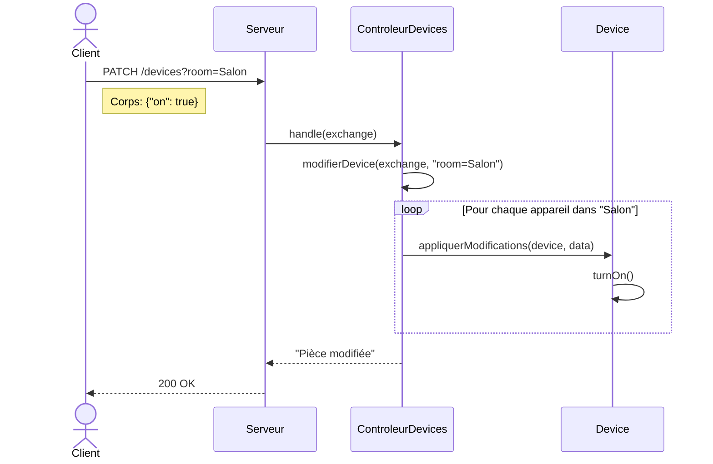

# TP1 — API Maison Intelligente

## Pièces (`/rooms`)

### Lister les pièces
**GET** `/rooms`

**Réponse 200 :**
```json
["Chambre", "Cuisine", "Salon"]
```

---

### Ajouter une pièce
**POST** `/rooms`

**Corps :**
```json
{"nom": "Garage"}
```

**Réponses :**
- `200` — Pièce ajoutée
- `409` — Pièce existante

---

### Supprimer une pièce
**DELETE** `/rooms`

**Corps :**
```json
{"nom": "Garage"}
```

**Réponses :**
- `200` — Pièce supprimée
- `404` — Pièce introuvable

---

## Appareils (`/devices`)

### Lister tous les appareils
**GET** `/devices`

**Réponse 200 :**
```json
[
  {"id": 1, "subtype": "Light", "on": false, "room": "Salon", 
   "intensity": 80, "colorTemp": 3200},
  {"id": 2, "subtype": "Camera", "on": false, "room": "Cuisine", 
   "nbDetections": 0}
]
```

---

### Lister par pièce
**GET** `/devices?room={nom}`

**Exemple :** `GET /devices?room=Salon`

---

### Lister par type
**GET** `/devices?subtype={type}`

Types disponibles : `Light`, `Camera`, `Vacuum`

**Exemple :** `GET /devices?subtype=Camera`

---

### Ajouter un appareil
**POST** `/devices`

**Corps (Light) :**
```json
{"subtype": "Light", "on": false, "room": "Salon", 
 "intensity": 80, "colorTemp": 3200}
```

**Corps (Camera) :**
```json
{"subtype": "Camera", "on": false, "room": "Cuisine"}
```

**Corps (Vacuum) :**
```json
{"subtype": "Vacuum", "on": false, "room": "Chambre"}
```

**Réponse 200 :** l'`id` généré (ex: `1`)

---

### Supprimer un appareil
**DELETE** `/devices?id={id}`

**Réponses :**
- `200` — Appareil supprimé
- `404` — Appareil introuvable

---

### Modifier un appareil spécifique
**PATCH** `/devices?id={id}`

**Corps (allumer/éteindre) :**
```json
{"on": true}
```

**Corps (modifier une lumière) :**
```json
{"intensity": 50, "colorTemp": 4000}
```

**Corps (action aspirateur) :**
```json
{"task": "Nettoyage d'une pièce", "room": "Chambre"}
```

**Réponses :**
- `200` — Appareil modifié
- `404` — Appareil introuvable

---

### Allumer/éteindre tous les appareils d'une pièce
**PATCH** `/devices?room={nom}`

**Corps :**
```json
{"on": true}
```

**Réponse 200 :** Pièce modifiée

### Diagramme


Client          Serveur         ControleurDevices      Light(s)
|                |                    |                  |
|--PATCH-------->|                    |                  |
| ?room=Salon    |                    |                  |
| {"on":true}    |                    |                  |
|                |--handle()--------->|                  |
|                |                   |--filter(Salon)--->|
|                |                   |                  |
|                |                   |--turnOn()-------->| (Light #1)
|                |                   |--turnOn()-------->| (Light #3)
|                |                   |                  |
|                |<--200 OK-----------|                  |
|<--200 OK-------|                    |                  |